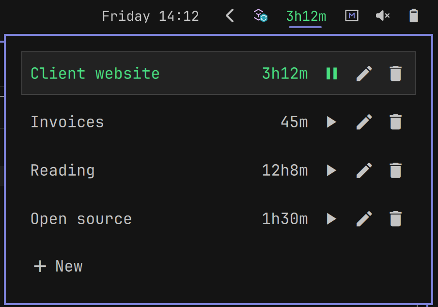

# Omahours

Time tracking per project in the Omarchy bar.



The bar shows the time of the project you used last: green while it runs, dark red while it is paused, dimmed `0m` before the first project exists. Times are shown in whole minutes, `40m` below an hour and `22h2m` above.

Left click opens the project list. Right click starts or pauses the last used project. Only one project runs at a time; starting another pauses the running one.

## Install

```sh
omarchy plugin add https://github.com/duderik/omahours --enable
```

The widget is placed in the right section of the bar. Move it with `omarchy bar move io.github.duderik.omahours --section <section>`.

## Remove

```sh
omarchy plugin remove io.github.duderik.omahours
```

Your project data stays in place (see Data).

## Panel

Each row shows the project name, its time, and buttons to start or pause, edit and delete. `+ New` at the bottom adds a project.

Keys while the panel is open:

| Key | Action |
|---|---|
| `j` `k` or arrows | select a row |
| `Enter` `Space` | start or pause |
| `e` | edit |
| `d` | delete |
| `n` | new project |
| `Esc` | cancel or close |

Editing turns the row into two fields, name and time. The time field accepts:

| Input | Effect |
|---|---|
| `2h22m`, `1h30`, `90m` | sets the time |
| `+2h22m` | adds |
| `-90m` | subtracts, never below zero |
| `0` | resets |

A single input is limited to 99999h. Names are compared as typed, so `abc` and `ABC` are two projects. An empty or duplicate name, or an invalid time, marks the field red and saves nothing. Deleting asks for confirmation below the row.

## Automatic pause

A running project pauses when the screen locks. Omarchy locks before every suspend, so closing the lid pauses as well. Time counts up to the moment of locking, checked every 10 seconds.

If the machine is switched off or the shell stops while a project runs, the plugin notices on the next start: it counts up to the last heartbeat, written once a minute, and pauses the project.

## Settings

| Key | Default | Meaning |
|---|---|---|
| `dataFile` | `~/.local/share/omahours/projects.json` | where projects are stored |

Set it in the bar settings or in `~/.config/omarchy/shell.json`:

```json
{ "id": "io.github.duderik.omahours", "dataFile": "~/Sync/omahours/projects.json" }
```

## Data

Projects are stored as JSON in the data file. It changes only when you start, pause, add, edit or delete a project, so a synced folder works. Two machines should not track time in the same file at the same time.

The heartbeat is kept separately in `~/.local/state/omahours/heartbeat`.

If the data file cannot be read, for example after a broken edit or a sync conflict, the bar shows `!`, the panel names the file, and nothing is written to it until it is fixed.

Nothing is sent over the network.

## Tests

```sh
node tests/model.test.js
node tests/model-extreme.test.js
```

## License

MIT, see [LICENSE](LICENSE).
